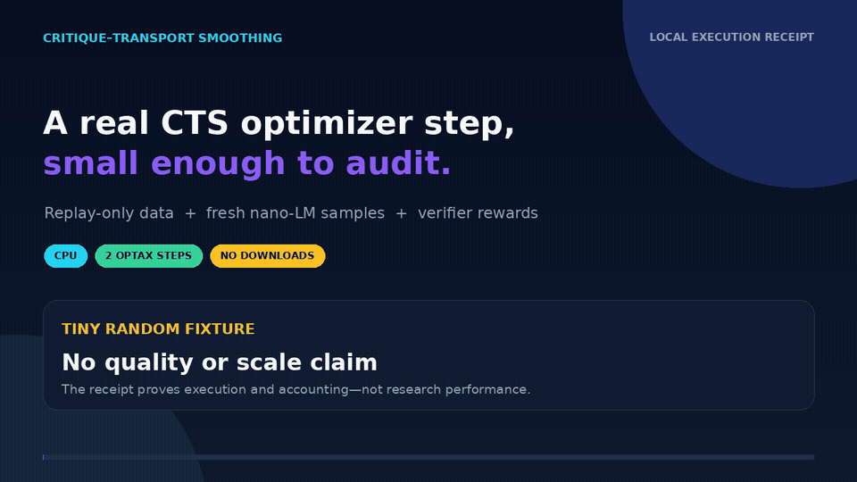

# Local CTS fixture demo

[](cts-fixture.mp4)

This is a visualization of an actual two-step CPU run from source tree `49d56d14413d3f6d5c539ef997a4766556c8ba3a`, published as commit `fddf9acfc3f3a16e338a3dd5b7e61c34cb1a34e6`. It shows the recorded comparison-group shapes, verifier rewards, optimizer logs, finite final loss, parameter delta, generated-token shape, and fairness fingerprint from `training-receipt.json` and `train.jsonl`.

The run used archived math fixture data, a tiny randomly initialized nano-LM, and no downloads or provider calls. The replay `y0`/`y1` pair guarantees a non-degenerate local verifier group while the third candidate proves fresh sampling executes. This demo makes no policy-quality, benchmark, scale, or paper-result claim.

These files are curated, source-pinned documentation assets under the narrow `AGENTS.md` demo exception. Runtime experiment outputs remain git-ignored under `artifacts/`.

```sh
PYTHONPATH=src JAX_PLATFORMS=cpu XLA_PYTHON_CLIENT_PREALLOCATE=false \
python -m cts.train.main \
  method=cts task=fixtures_math backend=local_nano \
  trainer.max_steps=2 trainer.warmup_steps=0 trainer.batch_size=2 \
  trainer.log_every=1 method_cfg.group_size=3 \
  method_cfg.max_new_tokens=8 method_cfg.max_len=48 \
  method_cfg.alignment.num_iters=5 method_cfg.alignment.use_ott=false \
  out_dir=artifacts/demo/cts-fixture
```

Re-render and verify:

```sh
python scripts/render_fixture_demo.py \
  --receipt docs/demo/training-receipt.json \
  --log docs/demo/train.jsonl \
  --gif docs/demo/cts-fixture.gif \
  --mp4 docs/demo/cts-fixture.mp4
python scripts/verify_fixture_demo.py
```
